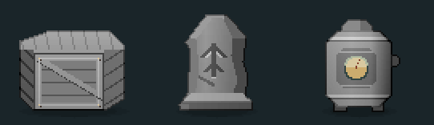
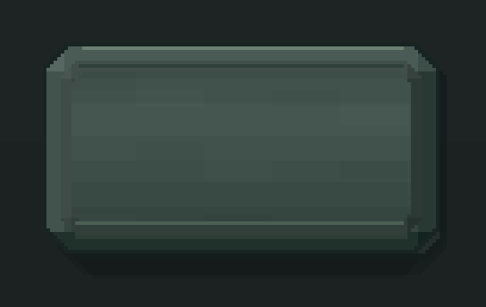

# Substanceprite

Расширение Aseprite для процедурных пиксельных материалов. Оно строит фактуру, наносит износ и отложения поверх исходного рисунка и хранит результат в редактируемых слоях спрайта.

## Демо

### Материалы



### Износ краски


### Детализация



### Освещение


## Установка

1. Скачайте [Substanceprite.aseprite-extension](download/Substanceprite.aseprite-extension?raw=true) и откройте его через **Edit → Preferences → Extensions → Add Extension** в Aseprite. В Windows и macOS файл можно открыть двойным щелчком. [Документация Aseprite](https://www.aseprite.org/docs/extensions/)
2. Перезапустите Aseprite, если приложение предложит это сделать. Команды находятся в меню **Sprite → Substanceprite**.
3. Для редактора материалов откройте RGB-спрайт с непрозрачными пикселями и выберите его слой или группу. Проверено на Aseprite 1.3.18.6.

## Материалы

1. Если нужно обработать только часть рисунка, сделайте выделение на холсте. Откройте **Sprite → Substanceprite → Materials…**.
2. Во вкладке **Material** выберите основу и настройте её фактуру. Кнопка **Browse…** открывает галерею процедурных сфер. Меню **Preview** переключает образец материала и результат на спрайте.
3. Во вкладке **Layers** нажмите **Add Effect**. Выберите маску слоя и отрегулируйте его цвета, интенсивность и распределение. Например, ограничьте мох углублениями, а потёртости краями.
4. Во вкладке **Output** проверьте результат и нажмите **Apply Material**. Aseprite создаст редактируемую группу материала. Выберите эту группу или один из её слоёв и снова откройте **Materials…**, чтобы продолжить работу.

| Основа | Рисунок поверхности |
| --- | --- |
| Bark | Борозды и неровные гребни коры |
| Wood Planks | Швы досок, волокна и сучки |
| Metal | Полосы обработки, поры и металлический блеск |
| Painted Metal | Окрашенный металл для сколов, износа и коррозии |
| Plastic | Мелкая фактура литья с мягким бликом |
| Stone | Грани и прожилки природного камня |
| Concrete | Матовая поверхность с порами и мелким заполнителем |

**Base Colors…** задаёт палитру основы. Цвета отдельного эффекта доступны в **Layers → Advanced Settings**. Порядок эффектов в стеке меняет итоговый рисунок.

### Карты и маски

Карта высот задаёт рельеф. Светлые участки выше тёмных. Высоты направляют сток и меняют распределение грязи и мха.

В **Surface Area** можно направить эффект на края, выступы, углубления, склоны, верх или низ. Нажмите **Edit Painted Mask** на выбранном эффекте, чтобы ограничить его кистью. Белый пропускает эффект, чёрный скрывает, серый ослабляет. Нарисованная маска умножается на выбранную область поверхности. Выберите **Painted Mask** в **Surface Area**, чтобы распределять эффект только кистью.

В однокадровом RGB-спрайте материал сохраняет полупрозрачность. В многокадровом спрайте он обрабатывает полностью непрозрачные пиксели выбранного кадра. **Edit Source** открывает исходный слой, а **Update Material** возвращает результат с учётом правок.

### Освещение

Во вкладке **Lighting** выберите **Height Source**. Для рельефа можно использовать яркость рисунка или отдельный слой карты высот.

- **Direct Light** моделирует освещение поверхности. Настройте направление, высоту, силу и оттенок света.
- **Cast Shadows** добавляет тени от выступов по тому же направлению света. **Relief Depth (px)** задаёт глубину рельефа, а мягкость регулирует край тени.
- **Ambient Occlusion** затемняет места рядом с выступами и внутри углублений. Радиус задаёт, насколько далеко распространяется это затемнение.

В меню **Preview** режим **Color** показывает результат с включёнными эффектами освещения. **Lit** позволяет заранее посмотреть прямой свет. Режимы **Ambient Occlusion** и **Cast Shadows** показывают геометрию затемнения в оттенках серого. Белый обозначает открытый свету участок.

Чтобы получить отдельный спрайт, во вкладке **Output** выберите **Map → Normal Map**, **Ambient Occlusion** или **Cast Shadows** и нажмите **Open Map Sprite**.

### Освещение готового спрайта

**Sprite → Substanceprite → Lighting…** открывает самостоятельный редактор для видимых слоёв RGB-спрайта. Он сохраняет результат в группе **Scene Lighting** поверх рисунка. Направленный свет, AO и падающие тени находятся на отдельных слоях.

- Вкладка **Light** содержит круг направления **Aim** и ползунки высоты, оттенка и силы света. Падающие тени и AO можно включать и настраивать независимо.
- В **Target** выберите карту высот в **Height Source** или используйте яркость рисунка. Для локальной правки можно ограничить результат выделением или открыть **Edit Mask** и рисовать по маске. Белый пропускает эффект, серый ослабляет, чёрный скрывает.
- **Preview → Compare** показывает исходник рядом с результатом. В том же меню доступны карты высот, AO и теней.

После **Apply Lighting** откройте **Lighting…** повторно на любом слое того же кадра. Настройки сохраняются в `.aseprite`, а изменение рисунка или карты высот пересчитывает освещение. Выделение ограничивает область применения, поэтому выступ за его пределами может отбрасывать тень внутрь. Освещаются полностью непрозрачные пиксели. При дублировании кадра копия сохраняет настройки группы и получает собственный расчёт по своему рисунку и карте.

### Краска и износ

В RGB-спрайте откройте **Sprite → Substanceprite → Paint & Wear…** на слое металла или нажмите **Paint Existing Metal…** во вкладке **Material**. В **Paint** выберите цвет и плотность покрытия. Исходная светотень задаёт распределение оттенков краски.

- **Wear** задаёт сколы (**Chips**), истирание кромок (**Edge Wear**), потёртости (**Scuffs**) и выцветание (**Fading**). Ширина кромки, направление потёртостей и Seed находятся в **Pattern Options**.
- **Weathering** добавляет ржавчину в сколах, потёки, грязь, мох и сажу. **Rain Settings** задаёт силу и длительность дождя. Потёки начинаются у ржавых участков и идут вниз с учётом рельефа.
- **Colors** редактирует тень, полутон и блик грунтовки, потёртостей, выцветания и отложений. Для раскраски покрытия в три тона выберите **Paint → Use Custom Paint Ramp**. У оголённого металла есть отдельный оттенок **Tint Exposed Metal**.
- **Maps & Masks** открывает редактируемую карту металла, карту высот и маски отдельных эффектов. Выберите слой карты и правьте его кистью. Белый на карте металла открывает сталь, а на карте высот обозначает выступ. После рисования выберите **Show Result**.

## Детали пропов

Откройте RGB-спрайт, выберите слой рисунка или группу материала и запустите **Sprite → Substanceprite → Prop Details…**.

1. В **Details** загрузите **Cargo Container** для грузового контейнера или **Industrial Panel** для корпуса оборудования. Добавляйте и переставляйте детали в списке. Доступны рамы, рейки, швы, крепёж, таблички, трафареты, решётки, вмятины и потёртости.
2. Во вкладке **Placement** щёлкните по превью, чтобы переместить выбранную деталь. Координаты, размеры и поворот можно уточнить ползунками. Во вкладке **Style** настройте цвет и силу, надпись или количество элементов. Трафарет использует латинские буквы и цифры высотой от пяти пикселей.
3. Во вкладке **Target** можно ограничить обработку выделением, выбрать исходную карту высот и включить **Relief Shadows** для теней от новых деталей. **Edit Mask** открывает общую маску. Белый пропускает детали, серый ослабляет, чёрный скрывает.
4. Нажмите **Apply Details**. Детали, карта высот и тени сохраняются в отдельной группе, а рисунок остаётся в исходном слое. Чтобы продолжить работу, выберите группу и откройте **Prop Details…**. Настроенные наборы можно сохранить через **Presets…**.

Детали рисуются по полностью непрозрачным пикселям текущего кадра. Сгенерированные слои пересчитываются после правок исходника и маски. Для ручной дорисовки создайте отдельный слой.

### Библиотека альф

**Sprite → Substanceprite → Alpha Library…** открывает 24 альфы. В **Damage** собраны сколы, царапины, трещины, пробоины и вмятины. В **Grilles** есть жалюзи, сетка, перфорация и решётки с повреждёнными планками. В **Hardware** можно выбрать болты, заклёпки, сварной шов, петлю и табличку.

Чтобы применить альфу, нажмите **Add Alpha…** в **Prop Details** и выберите штамп. В **Style** можно сменить форму, цвет и рельеф. **Auto** использует рельеф самой альфы, **Raised** поднимает участок, **Recessed** углубляет, **Color Only** окрашивает поверхность без изменения карты высот. Положение, размер и поворот задаются во вкладке **Placement**.

**Open Alpha Sprite** в библиотеке открывает отдельный спрайт с белой маской на прозрачном фоне. Частичное покрытие хранится в альфа-канале PNG.

## Остальные инструменты

- **Color Ramp Generator** строит Deep Shadow, Shadow, Light и Highlight вокруг выбранного цвета. Есть пять художественных пресетов и настройки оттенка, насыщенности, яркости и контраста. Цвета из превью можно добавить в палитру Aseprite.
- **Height Map from Art** преобразует яркость или цветовой канал исходного рисунка в слой карты высот.
- **Texture Generator** наносит отдельные эффекты как новый слой. Настраиваются плотность, масштаб, интенсивность, кластеризация, цвета и Seed. Применение к выделению, ограничение силуэтом и бесшовная генерация доступны в диалоге.
- **Linked Weathering** открывает специализированный редактор связанных сколов, ржавчины и потёков. Работает с RGB-спрайтами.

Изменения спрайта, сделанные командами расширения, можно отменить через **Edit → Undo**. Для повторяемости процедурных эффектов используйте одинаковый Seed.

## Исходники и сборка

Код написан на Lua 5.4. Для сборки нужен Python 3.9 или новее. Из корневой папки исходников выполните следующие команды.

```sh
lua5.4 tests/run.lua
python tools/package.py --source-output dist/Substanceprite-source.zip
```

Если ваш Lua 5.4 называется `lua`, запустите `lua tests/run.lua`. В Linux и macOS команда Python часто называется `python3`. В папке `dist/` появятся устанавливаемый файл `Substanceprite.aseprite-extension` и ZIP с исходниками.

В Aseprite можно запустить нативные проверки через CLI.

```sh
aseprite -b --script tests/aseprite_smoke.lua
aseprite -b --script tests/material_project_smoke.lua
aseprite -b --script tests/material_lighting_smoke.lua
aseprite -b --script tests/prop_details_smoke.lua
aseprite -b --script tests/scene_lighting_smoke.lua
```

Расширение распространяется по [лицензии MIT](LICENSE). Схема проекта, проверки и способ добавить генератор описаны в [CONTRIBUTING.md](CONTRIBUTING.md).
