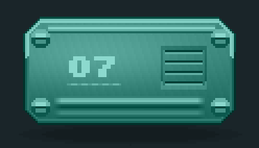
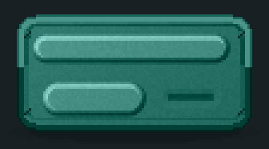
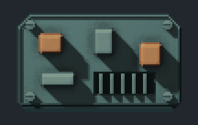

# Substanceprite

An Aseprite extension for procedural pixel-art materials. Add texture, wear, and surface deposits to your artwork and keep the results in editable sprite layers.

## Demos

### Materials


### Paint wear



### Bevel wear



### Prop details


### Lighting



## Installation

1. Download [Substanceprite.aseprite-extension](download/Substanceprite.aseprite-extension?raw=true) and open it in Aseprite under **Edit → Preferences → Extensions → Add Extension**. On Windows and macOS, you can also double-click the file. [Aseprite documentation](https://www.aseprite.org/docs/extensions/)
2. Restart Aseprite if prompted. Find the extension commands under **Sprite → Substanceprite**.
3. To use the material editor, open an RGB sprite and select a layer or group with opaque artwork. Tested with Aseprite 1.3.18.6.

## Materials

1. To process only part of your artwork, make a selection on the canvas. Open **Sprite → Substanceprite → Materials…**.
2. In **Material**, choose a base and adjust its texture. **Browse…** opens the gallery of procedural material spheres. Use **Preview** to switch between the material sample and the result on your sprite.
3. In **Layers**, click **Add Effect**. Choose a layer mask and adjust its colors, strength, and coverage. For example, you can keep moss in cavities and wear along edges.
4. In **Output**, check the result and click **Apply Material**. Substanceprite creates an editable material group. To continue editing, select the group or any of its layers and reopen **Materials…**.

| Base | Surface features |
| --- | --- |
| Bark | Furrows and uneven ridges |
| Wood Planks | Subtle joints, grain, and knots |
| Metal | Mottled, lightly brushed steel with a continuous surface |
| Painted Metal | Painted steel with shallow panel joints, ready for chips and corrosion |
| Plastic | Fine molded texture with a soft highlight |
| Stone | Natural facets and veins |
| Concrete | Matte finish with pores and fine aggregate |

Use **Base Colors…** to set the base palette. Individual effect colors are under **Layers → Advanced Settings**. Changing the order of effects changes how they build up on the surface.

To use the current default palette on an existing material, choose **Base Colors… → Reset → Use Colors**. This keeps the rest of the material settings.

### Maps and masks

The height map defines the surface relief. Brighter values represent higher points. The relief guides runoff and affects where dirt and moss build up.

Use **Surface Area** to place effects on edges, raised areas, cavities, slopes, the top, or the bottom. Click **Edit Painted Mask** on the selected effect to refine its coverage with a brush. White shows the effect, black hides it, and gray reduces its strength. The painted mask multiplies the selected surface mask. Choose **Painted Mask** in **Surface Area** to control coverage entirely by painting.

Materials preserve partial transparency in single-frame RGB sprites. On multi-frame sprites, they process fully opaque pixels in the selected frame. **Edit Source** opens the original layer. Use **Update Material** to regenerate the result after editing.

### Material lighting

In **Lighting**, choose a **Height Source**. You can derive relief from the artwork's brightness or use a dedicated height map layer.

- **Direct Light** sets the direction, elevation, strength, and tint of the light.
- **Cast Shadows** uses the same light direction to cast shadows from raised features. **Relief Depth (px)** sets the depth, and softness controls the shadow edge.
- **Ambient Occlusion** darkens cavities and areas near raised features. The radius sets how far this shading extends.

Under **Preview**, **Color** shows the result with the enabled lighting effects. **Lit** previews direct lighting. **Ambient Occlusion** and **Cast Shadows** show grayscale maps. White indicates an unoccluded area.

To open a map as a separate sprite, choose **Normal Map**, **Ambient Occlusion**, or **Cast Shadows** from **Output → Map**, then click **Open Map Sprite**.

### Scene lighting

**Sprite → Substanceprite → Lighting…** opens a standalone lighting editor for the visible layers of an RGB sprite. It stores direct light, ambient occlusion, and cast shadows on separate layers in a **Scene Lighting** group above the artwork.

- In **Light**, use **Aim** and the elevation, tint, and strength controls to place the light. Cast shadows and ambient occlusion have independent controls.
- In **Target**, select a height map under **Height Source** or use the artwork's brightness. To light a specific area, make a selection or paint a mask with **Edit Mask**. White shows the effect, gray reduces it, and black hides it.
- **Preview → Compare** shows the original and lit artwork side by side. The menu also includes height, ambient occlusion, and shadow previews.

After clicking **Apply Lighting**, you can reopen **Lighting…** from any layer in the same frame. Settings are saved in the `.aseprite` file, and edits to the artwork or height map recalculate the lighting. A selection limits which pixels receive light and shade, so raised features outside it can cast shadows into it. Lighting applies to fully opaque pixels. Duplicating a frame copies its settings and recalculates lighting for the duplicate's artwork and height map.

### Paint and wear

Select a metal layer in an RGB sprite and open **Sprite → Substanceprite → Paint & Wear…**, or click **Paint Existing Metal…** in **Material**. In **Paint**, choose the coating color and coverage. The paint follows the shading of the original sprite.

- **Wear** controls **Chips**, **Bevel Wear**, **Edge Wear**, **Scuffs**, and **Fading**. Find **Bevel Width (px)**, edge width, scuff direction, and Seed under **Pattern Options**.
- **Weathering** adds rust on exposed metal, runoff streaks, dirt, moss, and soot. **Rain Settings** controls rain strength and duration. Streaks begin at rusty areas and run downhill along the relief.
- **Colors** sets shadow, midtone, and highlight colors for primer, scuffs, fading, and deposits. For a three-color paint ramp, select **Paint → Use Custom Paint Ramp**. **Tint Exposed Metal** controls the color of exposed steel.
- **Maps & Masks** opens the editable metal map, height map, and individual effect masks. Select a map layer and edit it with the brush. White exposes steel on the metal map and marks raised areas on the height map. Click **Show Result** when finished.

#### Bevel wear

Choose a height map under **Maps & Masks → Initial Height** when painting a new material. On an existing painted material, adjust the saved map with **Edit Height Map**. Raise **Wear → Bevel Wear** to expose the original steel along convex bevels and raised shoulders. **Preview → Bevel Coverage** shows where paint will be removed. **Bevel Width (px)** lets the wear extend onto the raised face.

**Bevel Wear** starts at `0` (off) and keeps the original shading. **Weathering → Rust on Metal** adds patches of oxide to exposed bevels as rain runs over them or collects against the relief. **Rain Strength** and **Rain Duration** control how much new oxide develops. Set either rain control to `0` for clean, freshly worn bevels. With **Rust Trails** enabled, rain carries pigment from rusty bevels onto the coating below. Use the **Bevel Wear** effect mask to protect parts of the surface.

## Prop details

Open an RGB sprite, select an artwork layer or material group, and go to **Sprite → Substanceprite → Prop Details…**.

1. In **Details**, load **Cargo Container** or **Industrial Panel**. Add and reorder frames, rails, seams, fasteners, plates, stencils, grilles, dents, and scuffs.
2. In **Placement**, click the preview to position the selected detail. Use the sliders to adjust its position, dimensions, and rotation. In **Style**, set the color, strength, text, or element count. Stencils use Latin letters and digits at least five pixels tall.
3. In **Target**, limit the effect to the selection, choose a source height map, or enable **Relief Shadows**. **Edit Mask** opens the shared mask. White shows details, gray weakens them, and black hides them.
4. Click **Apply Details**. The details, height map, and shadows are stored in their own group above the original artwork. To edit them again, select the group and reopen **Prop Details…**. Save detail sets through **Presets…**.

Details apply to fully opaque pixels in the current frame. Generated layers recalculate after edits to the original artwork or mask. Use a separate layer for hand-painted finishing touches.

### Alpha library

**Sprite → Substanceprite → Alpha Library…** opens a library of 24 alpha stamps. **Damage** includes chips, scratches, cracks, holes, and dents. **Grilles** includes louvers, mesh, perforations, and grilles with broken slats. **Hardware** includes bolts, rivets, a weld seam, a hinge, and a plate.

To apply a stamp, click **Add Alpha…** in **Prop Details**. In **Style**, adjust the shape, color, and relief. **Auto** uses the stamp's own relief, **Raised** lifts it, **Recessed** sinks it, and **Color Only** leaves the height map intact. Use **Placement** to set the position, size, and rotation.

**Open Alpha Sprite** opens a white mask on a transparent background in a separate sprite. The PNG alpha channel stores partial coverage.

## Other tools

- **Color Ramp Generator** builds Deep Shadow, Shadow, Light, and Highlight swatches around a chosen color. It has five presets and hue, saturation, lightness, and contrast controls. Add the previewed colors to your Aseprite palette.
- **Height Map from Art** converts the artwork's luminance or a color channel into a height map layer.
- **Texture Generator** applies individual effects as new layers. Adjust density, scale, intensity, clustering, colors, and Seed. The dialog also has options for selection, silhouette, and seamless generation.
- **Linked Weathering** provides a dedicated editor for linked chips, rust, and streaks on RGB sprites.

Use **Edit → Undo** to undo changes to the sprite. Reuse the same Seed to reproduce a procedural effect.

## Build from source

Substanceprite is written in Lua 5.4. Building the archives requires Python 3.9 or later. From the repository root, run the following commands.

```sh
lua5.4 tests/run.lua
python tools/package.py --source-output dist/Substanceprite-source.zip
```

If your Lua 5.4 executable is named `lua`, use `lua tests/run.lua`. On Linux and macOS, the Python command may be `python3`. The `dist/` directory will contain the installable extension and the source ZIP.

Run the Aseprite integration tests through the CLI.

```sh
aseprite -b --script tests/aseprite_smoke.lua
aseprite -b --script tests/material_project_smoke.lua
aseprite -b --script tests/material_lighting_smoke.lua
aseprite -b --script tests/prop_details_smoke.lua
aseprite -b --script tests/scene_lighting_smoke.lua
```

Substanceprite is distributed under the [MIT License](LICENSE). See the [contributing guide](CONTRIBUTING.md) for project structure, tests, and how to add a generator.
